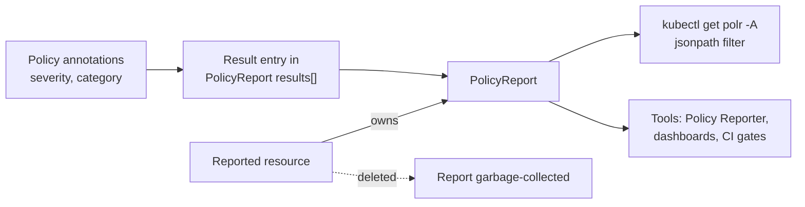

# Severity, Categories & Consuming Reports

A report that says "twelve failures" is a start. The question your team asks next is "which of them matter, and who owns them?" Kyverno gives you a small amount of metadata to answer it, and the reports are ordinary Kubernetes objects, so everything you already know about `kubectl` output, filters and garbage collection applies.

This module is about using reports at scale. You will learn how a policy's severity and category reach each result, how to count findings across every namespace, what happens to a report when a resource or a policy goes away, and where tools such as Policy Reporter fit in.

## How this module is organised

1. **[Part 1 — Severity and Category in Results](./course-01-severity-and-category-in-results.md)** — the two annotations, where they land, and how to count findings across namespaces.
2. **[Part 2 — Report Lifecycle and the Tool Ecosystem](./course-02-report-lifecycle-and-tooling.md)** — what deletes a report or a result, what Enforce leaves out, and what a tool such as Policy Reporter adds.
3. **[Summary](./course-03-summary.md)** — the facts to keep.

## Learning objectives

After this module you can:

- Set `policies.kyverno.io/severity` and `policies.kyverno.io/category` on a policy and find both on the result entries it produces.
- Count `fail` results by severity across all namespaces with a jsonpath filter.
- Include cluster-scoped findings by reading `ClusterPolicyReport` objects as well.
- Explain what happens to a report when its resource is deleted and what happens to results when a policy is deleted.
- Explain why a request that `Enforce` rejects does not produce a report entry.
- Describe what Policy Reporter does with reports and why it does not change what a result means.

## Before you start

You should have completed Modules 1 and 2: you can read a `PolicyReport`, you know the five result values, and you know the background scan runs on an interval. The linked playground and lab give you a kind cluster with Kyverno v1.13.2, two team namespaces and Pods that already violate policies.

Launch your playground now, and keep it running next to you while you read the parts:

<!-- astrona:playground -->
