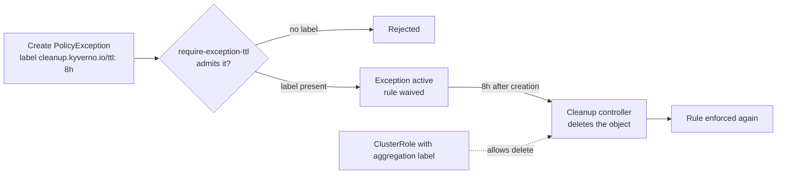

# Time-Boxed Exceptions & Cleanup

An exception that never ends is a policy hole with paperwork. Module 2 made exceptions narrow and governed; this module makes them temporary, so that the waiver you granted for a migration is gone when the migration is.

Kyverno does not have an "expires" field on a `PolicyException`. What it has is a general-purpose cleanup mechanism: put the label `cleanup.kyverno.io/ttl` on any object and the **cleanup controller** deletes it when the time is up. That works on exceptions as well as on anything else, but only if the controller is allowed to delete them, and only if you make sure nobody forgets the label.

## How this module is organised

1. **[Part 1 — Why Exceptions Need an End Date](./course-01-why-exceptions-need-an-end-date.md)** — the decay problem, the `cleanup.kyverno.io/ttl` label and the RBAC the cleanup controller needs.
2. **[Part 2 — Enforcing and Reviewing Time-Boxed Exceptions](./course-02-enforcing-and-reviewing-time-boxed-exceptions.md)** — a policy that requires the label, a renewal process and what an expiry looks like in the reports.
3. **[Summary](./course-03-summary.md)** — the module on one page.

## Learning objectives

After this module you can:

- Explain why an open-ended exception is a risk and what makes a good expiry.
- Put a `cleanup.kyverno.io/ttl` label on a `PolicyException` and predict when it will be removed.
- Grant the cleanup controller the right to delete exceptions through an aggregated ClusterRole.
- Write a policy that rejects any `PolicyException` without a ttl.
- Describe a renewal process that does not depend on someone's memory.
- Say what happens to a workload's report result when its exception expires.

## Before you start

You should have finished Modules 1 and 2. The linked lab starts with exceptions enabled and an Enforce policy in place, and asks you to wire up the cleanup path and create an exception that ends on its own.

Launch your playground now, and keep it running next to you while you read the parts:

<!-- astrona:playground -->
