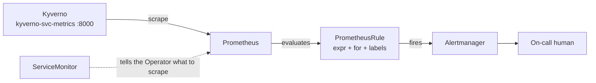

# Querying Metrics & Writing Alert Rules

Module 2 gave you control over what Kyverno exposes. This module is about what you do with it: read the numbers, ask them useful questions and turn the important questions into alerts that wake the right person for the right reason.

A raw `/metrics` page is a wall of counters that only ever go up. Two ideas carry most of the weight. First, a counter's value on its own means little, so you ask how much it changed over a window. Second, an alert is a query plus a threshold plus a duration, not a single high sample.

## How this module is organised

1. **[Part 1 — Reading Kyverno Metrics with PromQL](./course-01-reading-kyverno-metrics-with-promql.md)** — counters, `increase`, `rate`, `sum by`, and `histogram_quantile` for latency.
2. **[Part 2 — Alert Rules That Matter](./course-02-alert-rules-that-matter.md)** — `ServiceMonitor` and `PrometheusRule`, the four alerts worth having and how to keep them quiet.
3. **[Summary](./course-03-summary.md)** — the module on one page.

## Learning objectives

After this module you can:

- Explain why a counter is queried with `increase()` or `rate()` rather than read directly.
- Write a PromQL query for policy failures per policy over a window.
- Compute a latency percentile from a histogram and say what limits its accuracy.
- Distinguish a `ServiceMonitor` from a `PrometheusRule`.
- Write an alert with an expression, a `for:` duration, a severity label and an annotation.
- Choose a small set of alerts that matter for a Kyverno installation.

## Before you start

You should have completed Modules 1 and 2: you can scrape the endpoint from a Pod and you know which labels are on or off. The Prometheus Operator is a separate project and is not installed in the lab cluster, so the lab asks you to write an alert rule as a manifest and check its content rather than running it.

Launch your playground now, and keep it running next to you while you read the parts:

<!-- astrona:playground -->
