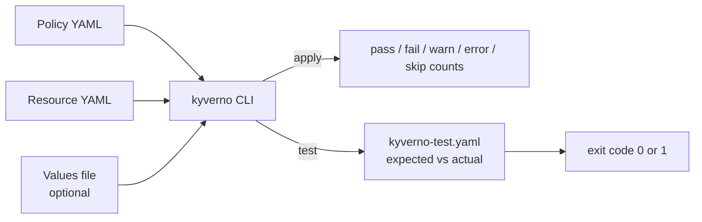

# Testing Policies with the Kyverno CLI

You have read reports, granted exceptions and watched metrics. All of that happens after a policy reaches a cluster. This module covers the step before: proving that a policy does what you think it does, without a cluster, before anyone applies it.

The Kyverno command-line tool (`kyverno`) evaluates policies against resource files on your own machine. `kyverno apply` runs a policy once and prints the outcome. `kyverno test` runs a set of declared expectations and fails when a result differs. Together they let you put policy checks into a pull request or a CI (continuous integration) pipeline.

## How this module is organised

1. **Running a policy with kyverno apply** - policy and resource files, the result counts, and the flags that change the output.
2. **Writing kyverno-test.yaml** - the Test file, its `results` list and how Kyverno matches expected results to actual ones.
3. **Variables, mutate and generate tests** - values files, user information and the `patchedResource` and `generatedResource` fields.
4. **Running tests in CI** - exit codes, filtering test cases, report output and where tests belong in a repository.
5. **Summary** - the module on one page.

## Learning objectives

After this module you can:

- Run `kyverno apply` against local files and read its pass, fail, warn, error and skip counts.
- Explain the difference between `kyverno apply` and `kyverno test`.
- Write a `kyverno-test.yaml` with one expected result per policy, rule and resource.
- Test a mutate rule with `patchedResource` and a generate rule with `generatedResource`.
- Supply `request.*` and other variables with a values file.
- Run `kyverno test` in a pipeline and use its exit code to stop a bad change.

## Before you start

You should know what a `ClusterPolicy` is and how a validate rule reports a result. The playground has the `kyverno` CLI v1.13.2 installed and a working directory with a sample policy and resources. No cluster is needed for these commands.

Launch your playground now, and keep it running next to you while you read the parts:

<!-- astrona:playground -->
